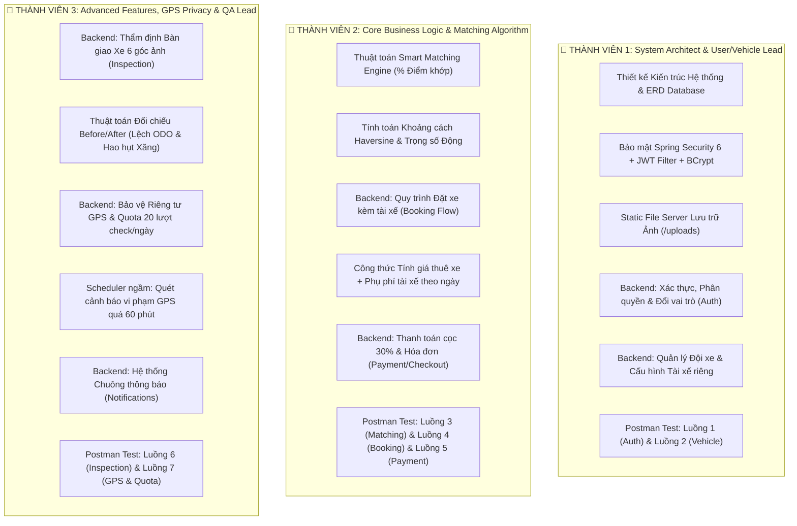

# BẢNG PHÂN CHIA CÔNG VIỆC TỔNG THỂ DỰ ÁN (DÀNH CHO 3 THÀNH VIÊN)
**Dự án:** Hệ thống Thuê xe Tự lái & Kèm Tài xế Thông minh (AutoRental System)  
**Môn học:** **PRM393 - Mobile Application Development** (FPT University)  
**Phạm vi:** Kiến trúc Hệ thống, Backend Java Spring Boot 3, Cơ sở dữ liệu, Thuật toán, API Testing Postman & Báo cáo Đồ án.

---

## I. MA TRẬN TRÁCH NHIỆM CHUNG (RACI MATRIX)

---

## II. BẢNG PHÂN CÔNG CHI TIẾT TỪNG THÀNH VIÊN

### 👤 THÀNH VIÊN 1: TRƯỞNG NHÓM (TEAM LEAD)
**Chuyên trách:** Kiến trúc Cơ sở dữ liệu, Hạ tầng Bảo mật JWT, Phân hệ Quản lý Tài khoản & Đội xe

#### 1. Trách nhiệm Cơ sở Dữ liệu & Cấu hình:
- Thiết kế Entity JPA & Quan hệ:
  - `User`, `Role` (Mô hình Dual Role: Khách thuê $\leftrightarrow$ Chủ xe)
  - `Vehicle`, `VehicleImage`, `VehicleType`, `TransmissionType`, `FuelType`, `VehicleStatus`
- Cấu hình hạ tầng:
  - Spring Security 6 + JWT Stateless Interceptor (`JwtAuthenticationFilter`, `JwtTokenProvider`).
  - Hệ thống lưu trữ ảnh tĩnh nội bộ `FileStorageService` + `WebMvcConfig` (thay thế Cloudinary, lưu vào thư mục `uploads/`).
  - Viết bộ dữ liệu mẫu khởi tạo `DataSeeder` (Tạo sẵn tài khoản Chủ xe `owner@gmail.com` và Khách thuê `renter@gmail.com` + 3 mẫu xe).

#### 2. Trách nhiệm Backend API:
- `AuthController`:
  - `POST /api/auth/register` (Đăng ký tài khoản kèm CCCD, GPLX)
  - `POST /api/auth/login` (Đăng nhập, sinh mã JWT)
  - `GET /api/auth/profile` (Lấy thông tin cá nhân)
  - `PUT /api/auth/switch-role` (**Nghiệp vụ 1: Chuyển đổi qua lại giữa RENTER $\leftrightarrow$ OWNER**)
- `VehicleController` & `FileUploadController`:
  - `POST /api/vehicles` (**Nghiệp vụ 1: Chủ xe đăng xe, switch có lái xe + phụ phí tài xế/ngày**)
  - `GET /api/vehicles/owner` (Lấy danh sách xe của tôi)
  - `PUT /api/vehicles/{id}/status` (Đổi trạng thái xe: Sẵn sàng, Bảo dưỡng, v.v.)
  - `POST /api/upload` (Upload hình ảnh xe lên máy chủ)

#### 3. Trách nhiệm Kiểm thử Postman & Tài liệu:
- Chịu trách nhiệm kiểm thử và đảm bảo pass 100% cho:
  - **Folder 1:** `1. Authentication & Dual-Role (Nghiệp vụ 1)`
  - **Folder 2:** `2. Vehicle Management (Quản lý xe)`
- Viết phần Báo cáo: Giới thiệu dự án, Sơ đồ kiến trúc phần mềm, Sơ đồ quan hệ thực thể (ERD) và Class Diagram.

---

### 👤 THÀNH VIÊN 2: CORE BUSINESS DEVELOPER
**Chuyên trách:** Thuật toán Khớp xe Thông minh (Matching Engine), Quy trình Đặt xe & Thanh toán Cọc

#### 1. Trách nhiệm Cơ sở Dữ liệu:
- Thiết kế Entity JPA & Quan hệ:
  - `Booking`, `BookingStatus` (`PENDING`, `CONFIRMED`, `IN_PROGRESS`, `COMPLETED`, `CANCELLED`)
  - `Payment` (Hóa đơn cọc 30%, mã giao dịch `TXN_xxx`, phương thức thanh toán)

#### 2. Trách nhiệm Backend & Giải thuật:
- `MatchingService` & `MatchingController` (**Nghiệp vụ đặc thù 4 - Smart Matching Engine**):
  - Lập trình công thức tính khoảng cách **Haversine** dựa trên kinh độ - vĩ độ thực tế:
    $$d = 2R \cdot \arcsin\left(\sqrt{\sin^2\left(\frac{\Delta\phi}{2}\right) + \cos(\phi_1)\cos(\phi_2)\sin^2\left(\frac{\Delta\lambda}{2}\right)}\right)$$
  - Thuật toán chuẩn hoá điểm số lệch giá (Budget deviation score).
  - Trọng số tương thích động (Dynamic Weights) theo cấu hình từ request: Giá cả, Vị trí gần, Hộp số, Loại xe, Đánh giá sao.
  - Điểm tương thích cuối cùng $Score \in [0, 100\%]$ trả về cho mỗi xe.
  - API: `POST /api/matching/search`
- `BookingService` & `BookingController` (**Nghiệp vụ đặc thù 1 - Thuê xe kèm tài xế**):
  - Công thức tính tiền tổng:
    $$\text{TotalPrice} = (\text{BasePrice} + \text{DriverFee}) \times \text{RentalDays}$$
  - Kiểm tra xung đột lịch đặt (Double-booking validation).
  - API: `POST /api/bookings` (Tạo đơn), `GET /api/bookings/my-history`, `PUT /api/bookings/{id}/approve`.
- `PaymentService` & `PaymentController`:
  - Xử lý đặt cọc tối thiểu 30% tổng đơn, sinh chuỗi nội dung VietQR chuyển khoản.
  - API: `POST /api/payments/checkout`, `GET /api/payments/booking/{bookingId}`.

#### 3. Trách nhiệm Kiểm thử Postman & Tài liệu:
- Chịu trách nhiệm kiểm thử và đảm bảo pass 100% cho:
  - **Folder 3:** `3. Smart Matching Engine (Nghiệp vụ 4)`
  - **Folder 4:** `4. Booking Flow (Nghiệp vụ 1)`
  - **Folder 5:** `5. Payment & Checkout (Thanh toán cọc)`
- Viết phần Báo cáo: Tài liệu đặc tả giải thuật Matching %, Bảng công thức tài chính cọc - hoàn trả, Sơ đồ Sequence Diagram cho luồng Đặt xe & Thanh toán.

---

### 👤 THÀNH VIÊN 3: ADVANCED FEATURES & QA/TEST LEAD
**Chuyên trách:** Phân hệ Thẩm định Biên bản 6 góc ảnh, Bảo vệ Riêng tư GPS & Quản lý Chất lượng Kiểm thử

#### 1. Trách nhiệm Cơ sở Dữ liệu & Scheduler:
- Thiết kế Entity JPA & Quan hệ:
  - `Inspection`, `InspectionStage` (`CHECK_IN`, `CHECK_OUT`), lưu vết 6 URL ảnh, ODO km, mức xăng % và chữ ký số 2 bên.
  - `GpsLog`, `GpsQuota` (Lưu vết toạ độ và số lần truy vấn GPS trong ngày của chủ xe).
  - `Notification`, `NotificationType` (`GPS_WARNING`, `BOOKING_STATUS`, `INSPECTION_UPDATE`, `PAYMENT_UPDATE`).
- Lập trình tiến trình ngầm **Spring Scheduled Tasks**:
  - `GpsMonitorScheduler`: Cấu hình `@Scheduled(cron = "0 */5 * * * *")` tự động rà soát toàn bộ các cuốc xe đang `IN_PROGRESS`.
  - Tự động phát hiện vi phạm: Nếu quá 60 phút khách không gửi toạ độ $\rightarrow$ Tự động tạo bản ghi `GPS_WARNING` gửi cảnh báo.

#### 2. Trách nhiệm Backend API:
- `InspectionService` & `InspectionController` (**Nghiệp vụ đặc thù 3 - Biên bản thẩm định ảnh Before/After**):
  - `POST /api/inspections` (Tiếp nhận 6 ảnh: Front, Rear, Left, Right, Odo, Fuel + số km ODO + % Xăng).
  - `GET /api/inspections/comparison/{bookingId}` (Tính toán tự động: $\Delta \text{ODO} = \text{ODO}_{\text{out}} - \text{ODO}_{\text{in}}$, $\Delta \text{Xăng} = \text{Xăng}_{\text{out}} - \text{Xăng}_{\text{in}}$).
  - `PUT /api/inspections/{id}/confirm` (Cơ chế đồng thuận xác nhận 2 bên Khách & Chủ để hoàn tất cọc).
- `GpsService` & `GpsController` (**Nghiệp vụ đặc thù 2 - Bảo vệ quyền riêng tư GPS & Quota 20 lần**):
  - `POST /api/gps/ping` (Khách gửi toạ độ GPS kèm tốc độ).
  - `GET /api/gps/renter/{bookingId}/route` (Khách xem đầy đủ toàn bộ toạ độ lịch sử chuyến đi).
  - `GET /api/gps/owner/{bookingId}/snapshot` (Chủ xe **chỉ được xem 1 điểm tức thời**, tuyệt đối không xem lộ trình + Kiểm tra trừ hạn ngạch 20 lượt/ngày. Nếu hết quota $\rightarrow$ Ném mã `HTTP 429 Too Many Requests`).
  - `GET /api/gps/{bookingId}/status` (Kiểm tra xem cuốc xe có bị quá 60 phút chưa ping GPS không).
- `NotificationController`: Quản lý thông báo và đánh dấu đã đọc.

#### 3. Trách nhiệm Kiểm thử Postman & Tài liệu:
- Chịu trách nhiệm kiểm thử và đảm bảo pass 100% cho:
  - **Folder 6:** `6. Vehicle Inspection (Nghiệp vụ 3 - Before/After)`
  - **Folder 7:** `7. GPS Tracking & Privacy Quota (Nghiệp vụ 2)`
  - **Folder 8:** `8. Notifications (Cảnh báo quá 1h)`
- Quản lý và bảo trì file `AutoRental_Backend.postman_collection.json`.
- Viết phần Báo cáo: Đặc tả kỹ thuật bảo vệ quyền riêng tư người dùng theo chuẩn GDPR (chính sách 20 lần snapshot), Quy trình thẩm định xe bàn giao, Tổng hợp kết quả Kiểm thử tự động (Test Case Results).

