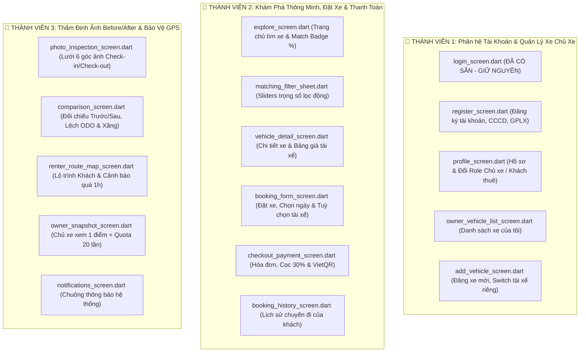

# BẢNG PHÂN CHIA NHIỆM VỤ FRONTEND FLUTTER (3 THÀNH VIÊN)
**Dự án:** Ứng dụng Thuê xe Tự lái & Kèm Tài xế (AutoRental) - Môn học **PRM393**  
**Khung kiến trúc:** Feature-First Clean Architecture

---

> [!NOTE]
> **Quy ước triển khai:**
> - Tất cả các file Service (`lib/data/services/`), Model (`lib/data/models/`), Network (`lib/core/network/`) và Theme/Colors (`lib/core/constants/`) đã được xây dựng hoàn thiện và sẵn sàng gọi API.
> - Duy nhất màn hình mẫu **[`login_screen.dart`](lib/features/auth/screens/login_screen.dart)** được giữ nguyên làm chuẩn.
> - Các màn hình khác của từng Feature đã được làm sạch để từng thành viên tự code và kiểm thử theo đúng hướng dẫn trong file `README.md` của thư mục tương ứng.

---

## TỔNG QUAN PHÂN BỔ 3 VAI TRÒ FRONTEND

---

## 1. THÀNH VIÊN 1: PHÂN HỆ TÀI KHOẢN & QUẢN LÝ XE CỦA CHỦ XE

### Trách nhiệm thư mục:
- `lib/features/auth/` $\rightarrow$ Đọc chi tiết tại [features/auth/README.md](lib/features/auth/README.md)
- `lib/features/vehicle_management/` $\rightarrow$ Đọc chi tiết tại [features/vehicle_management/README.md](lib/features/vehicle_management/README.md)

### Các màn hình phụ trách:
1. `features/auth/screens/login_screen.dart` : **(ĐÃ CÓ SẴN - GIỮ NGUYÊN)**.
2. `features/auth/screens/register_screen.dart` : Đăng ký (Họ tên, email, SĐT, CCCD, GPLX, lựa chọn vai trò ban đầu).
3. `features/auth/screens/profile_screen.dart` : Hồ sơ cá nhân + **Nút "Chuyển chế độ (Switch Role)"** hoán đổi Khách thuê $\leftrightarrow$ Chủ xe.
4. `features/vehicle_management/screens/owner_vehicle_list_screen.dart` : Danh sách xe của tôi (Trạng thái Rảnh/Đang thuê, giá/ngày, nút dẫn sang Đăng xe mới).
5. `features/vehicle_management/screens/add_vehicle_screen.dart` : **Nghiệp vụ đặc thù 1:** Form đăng xe mới (**Switch bật/tắt dịch vụ kèm tài xế + ô nhập phụ phí tài xế/ngày**).

---

## 2. THÀNH VIÊN 2: PHÂN HỆ KHÁM PHÁ MATCHING %, ĐẶT XE & THANH TOÁN

### Trách nhiệm thư mục:
- `lib/features/matching_explore/` $\rightarrow$ Đọc chi tiết tại [features/matching_explore/README.md](lib/features/matching_explore/README.md)
- `lib/features/booking/` $\rightarrow$ Đọc chi tiết tại [features/booking/README.md](lib/features/booking/README.md)

### Các màn hình phụ trách:
1. `features/matching_explore/screens/explore_screen.dart` : Trang chủ tìm xe, hiển thị thẻ xe có **Huy hiệu điểm tương thích % (Match Score Badge - Nghiệp vụ 4)**.
2. `features/matching_explore/widgets/matching_filter_sheet.dart` : **Nghiệp vụ 4:** Bộ lọc Matching thông minh với các thanh trượt Sliders (Giá rẻ, Vị trí gần tôi, Cần lái xe $\rightarrow$ Backend re-calculate điểm % theo thời gian thực).
3. `features/matching_explore/screens/vehicle_detail_screen.dart` : Chi tiết xe (Carousel ảnh, thông số kỹ thuật, bảng giá thuê tự lái + giá tài xế riêng).
4. `features/booking/screens/booking_form_screen.dart` : **Nghiệp vụ 1:** Tạo đơn đặt xe (Chọn ngày bằng `showDateRangePicker`, **Switch "Thuê kèm tài xế"**, tự động tính tổng tiền theo công thức).
5. `features/booking/screens/checkout_payment_screen.dart` 💳 : Hóa đơn chi tiết, cọc 30%, trả khi nhận xe 70%, chọn VietQR / MoMo / Tiền mặt.
6. `features/booking/screens/booking_history_screen.dart` : Danh sách chuyến đi của khách thuê, điều hướng sang GPS hoặc Thẩm định xe.

---

## 3. THÀNH VIÊN 3: PHÂN HỆ THẨM ĐỊNH XE & BẢO VỆ RIÊNG TƯ GPS

### Trách nhiệm thư mục:
- `lib/features/inspection/` $\rightarrow$ Đọc chi tiết tại [features/inspection/README.md](lib/features/inspection/README.md)
- `lib/features/gps_tracking/` $\rightarrow$ Đọc chi tiết tại [features/gps_tracking/README.md](lib/features/gps_tracking/README.md)

### Các màn hình phụ trách:
1. `features/inspection/screens/photo_inspection_screen.dart` : **Nghiệp vụ đặc thù 3:** Biên bản thẩm định xe (Lưới 6 góc ảnh từ Camera: Đầu, Đuôi, 2 Bên hông, ODO, Xăng; 2 ô nhập ODO km và % Xăng) cho cả `CHECK_IN` và `CHECK_OUT`.
2. `features/inspection/screens/comparison_screen.dart` : **Nghiệp vụ đặc thù 3:** Đối chiếu ảnh Trước & Sau Before/After (Ảnh nhận song song ảnh trả, hiển thị tự động độ lệch $\Delta \text{ODO}$ km và $\Delta \text{Xăng} \%$, xác nhận đồng thuận 2 bên).
3. `features/gps_tracking/screens/renter_route_map_screen.dart` : **Nghiệp vụ đặc thù 2:** Bản đồ khách thuê xem toàn bộ lộ trình + Nút Ping toạ độ GPS + **Banner cảnh báo vi phạm quy định nếu quá 60 phút chưa gửi toạ độ**.
4. `features/gps_tracking/screens/owner_snapshot_screen.dart` : **Nghiệp vụ đặc thù 2:** Bản đồ chủ xe (Chỉ xem 1 điểm tức thời, không xem lộ trình) + **Thanh đo Quota 20 lượt/ngày**, quá 20 lượt bị khoá (HTTP 429).
5. `features/gps_tracking/screens/notifications_screen.dart` : Chuông thông báo hệ thống (Cảnh báo GPS quá 1h, duyệt đơn, thẩm định xe, thanh toán).

